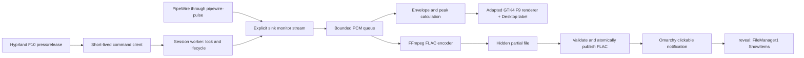
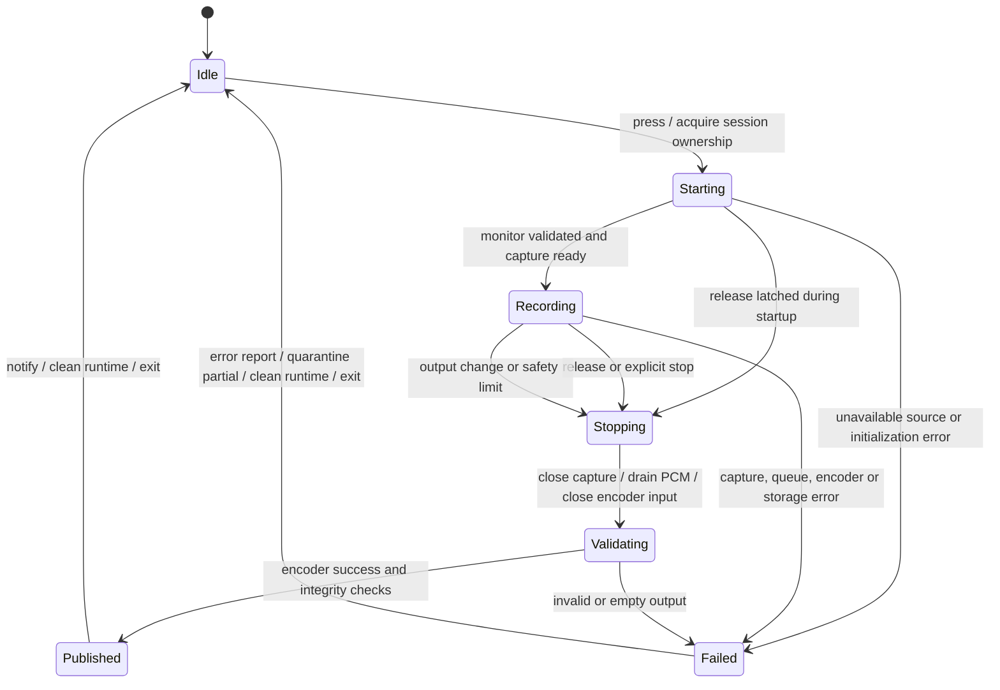

# Omarchy Desktop Audio Recorder: technical design and implementation plan

Version: 0.1, 5 November 2026. Original status: **proposed; implementation requires approval**.

Implementation update: the owner requested implementation on 5 November 2026
and approved C as the implementation language because Rust/Cargo were absent.
See [implementation status](implementation-status.md) for the built source and
acceptance work that remains. The proposal below remains the design reference;
it is not evidence that its interactive acceptance gates have passed.

## Decision summary

Build an on-demand user application that records the default output's monitor,
renders the existing Voxtype GTK4 waveform with a new **Desktop** label, saves
FLAC under `~/Music/Recordings/`, and sends an Omarchy notification whose click
opens the recording in the file manager. Keep F9, Voxtype's daemon, and all
packaged Omarchy files untouched.

Recommend a small Rust application using the already-installed GTK4,
gtk4-layer-shell and libpulse runtimes, with FFmpeg as its FLAC encoder. Reuse
selected MIT-licensed Voxtype renderer modules in an independently named binary,
not the whole transcription application. Distribute versioned prebuilt archives
with automated user-level install/uninstall scripts through the existing
Syncthing share. No permanent recorder service is needed.

Approval is particularly needed for the label's extra height, handling output
changes, multichannel policy, and an automatic recording safety limit (§I).
These are recommendations, not implemented behavior.

## A. Existing system analysis

### Evidence and limits

Inspection used local files, package metadata, executable help, read-only live
Hyprland/Pulse/D-Bus queries, and version-pinned upstream Voxtype source.
No keybindings were changed, no F9 session was started, no real audio was
recorded, and no notifications were sent. Consequently visual fidelity,
physical key behavior, recording reliability and click-through behavior remain
implementation-phase acceptance tests. Source-derived behavior is distinguished
below from observations of running processes.

The initial repository was empty: unborn `main`, no tracked or untracked project
files, no history, no remote and no upstream. There was no inherited work.

| Component | Observed installation |
| --- | --- |
| Omarchy package | `4.0.6-1` |
| Omarchy version file | `/usr/share/omarchy/version` says `4.0.0.alpha`; retain this discrepancy in compatibility checks |
| Hyprland | `0.56.2-4`, Lua configuration |
| PipeWire / pipewire-pulse | `1:1.6.9-1` |
| WirePlumber | `0.5.18-1` |
| Voxtype | `voxtype-bin 1.1.1-1` |
| GTK4 / gtk4-layer-shell | `1:4.24.1-1` / `1.3.0-1` |
| FFmpeg | `2:9.0.2-2`; Pulse input and FLAC encoder available |
| Quickshell | `0.3.2.r7.g2b4501a-1` |
| Nautilus | `51.1-1`; default handler for `inode/directory` |
| Syncthing | `2.1.7-1`; active user service |

`pactl`, `parec`, `pw-record`, `pw-cli`, `flac`, `notify-send` and Python are
installed. Rust/Cargo were not found on PATH; they are proposed build-machine
requirements, not requirements for installation on every target machine.

### F9: keyboard through capture and output

1. `~/.config/hypr/hyprland.lua` loads Omarchy's bootstrap and defaults, then
   user `hypr.bindings`. Packaged
   `/usr/share/omarchy/default/hypr/bindings/voxtype.lua` conditionally registers
   `voxtype record start` on F9 press and `voxtype record stop` with
   `{ release = true }`. Super+Ctrl+X also toggles dictation.
2. `/usr/share/omarchy/default/hypr/helpers.lua`, `o.bind`, delegates options to
   `hl.bind` and wraps string commands in an exec dispatcher. Live
   `hyprctl -j binds` confirms two unmodified F9 bindings, no repeat, no lock
   operation, and no F10 binding. Text inspection also found no F10 binding in
   the inspected user and default Hyprland trees. Installers must recheck other
   machines, including keycodes, modifiers and submaps.
3. Active `voxtype.service` uses `~/.config/systemd/user/voxtype.service`, running
   `/usr/bin/voxtype daemon`. Source maps the compositor start/stop CLI to
   SIGUSR1/SIGUSR2. The daemon owns recording state and ignores inappropriate
   transitions; the compositor does not itself capture audio.
4. `~/.config/voxtype/config.toml` disables Voxtype's own hotkey, selects the
   default audio input, 16 kHz, a 60-second maximum, and `pause_media = true`.
   Source `src/audio/mod.rs` selects CPAL capture; `cpal_capture.rs` averages
   source channels to mono and resamples when necessary, buffering samples for
   transcription. This capture path is inappropriate for music-quality output.
5. Voxtype's level emitter taps that same capture stream. Source
   `src/audio/levels.rs` emits 100 frames/second, each 16 bytes in native byte
   order: `u32 seq`, `f32 min`, `f32 max`, `f32 peak_dbfs`. Windows are 10 ms;
   these are envelope/peak data, not the complete PCM waveform.
6. The daemon supervises `/usr/bin/voxtype-osd`. The observed child is
   `/usr/lib/voxtype/voxtype-osd-gtk4`, **not** the separately shipped Quickshell
   frontend. The GTK frontend consumes `$XDG_RUNTIME_DIR/voxtype/audio.sock`.
7. Release stops microphone capture and begins Whisper transcription; configured
   output types text at the cursor, with clipboard fallback. Normal dictation
   does not create an automatically saved audio recording. The configured
   `on_recording_start`, `on_recording_stop` and `on_transcription` notifications
   are false; other error/no-speech notifications may still apply. F9's normal
   result is text, not a saved-file notification.

**Required behavioral differences:** F10 must not invoke dictation, pause media,
duck playback, transcribe, type text, alter the clipboard, or discard silence as
“no speech.” It shares press/hold/release and waveform behavior, but release
finalizes an audio file. Preserve F9's existing configuration and processes.

### Overlay: what can be reused

Installed help confirms GTK frontend options for a separate `--socket`, config,
dimensions, margin, gain and peak decay. It exposes **no label option**.
The packaged QML frontend has configurable visual layers and labels, but it is
not the active F9 renderer. Switching F9 to it would violate the preservation
requirement; using it only for F10 would require a new visual equivalence proof.

Reference source is Voxtype v1.1.1, Git tree/commit
`014c56105b2f071bb3457c51a95c38be380e5124`, fetched to a temporary research
directory. Package version matches the tag; binary reproducibility and any AUR
build patches were not established. Do not describe source defaults as measured
on-screen geometry.

| Renderer behavior from pinned source | Design consequence |
| --- | --- |
| `src/bin/voxtype_osd_gtk4.rs`: GTK DrawingArea/Cairo, layer-shell Overlay, keyboard mode None, empty input region, exclusive zone 0 | Reuse rendering and click-through semantics |
| `src/osd/config.rs`: defaults 400 × 48, top margin fraction 0.85, margin 24, 3-second waveform history, gain 10, peak decay 6 dB/s | Starting reference dimensions; compare with actual F9 before release |
| Centered positions anchor to the top with fractional height, despite enum default `BottomCenter` | Copy real placement logic, not enum-name assumptions |
| Monitor height lookup uses first suitable GDK monitor, despite its focused-monitor helper name; surface output is compositor assigned | Verify output selection on multiple displays; no hardcoded monitor |
| Waveform takes roughly 92% width, gap 1%, meter 7%; 10 meter segments, floor −60 dBFS | Preserve proportions and peak logic |
| `src/osd/ipc.rs`: 50 ms interpolation holdback, bounded history, sequence discontinuity resets | Reuse animation timing and reset between sessions |
| Visibility checks every 16 ms; no frames for 150 ms hides the window | Silence must still deliver frames; missing frames are different from zero amplitude |
| `src/osd/theme.rs`: active Omarchy theme palette loaded at startup; background alpha comes from fallback (0.85) | Match actual palette loading; do not promise GTK theme hot reload |
| `src/osd/visual.rs`: shared envelope, meter zones and peak hold | Reuse these small algorithms, not transcription dependencies |

F9's waveform/meter has no text, so it supplies no label typography to copy.
Use the session's GTK default font and foreground for “Desktop.” Its size and
spacing require a visual review. The user config contains no `[osd]` override,
so source defaults are the expected baseline, subject to visual confirmation.

A separate invocation of the original executable is insufficient: besides no
label, its application ID, namespace and Voxtype suppression-file lookup are
Voxtype-specific. Adapt these to application-owned names and remove all access
to F9 state. Reuse through an internal module snapshot with provenance and
small documented changes; never patch `/usr/share/omarchy` or `/usr/lib/voxtype`.

### Desktop audio, notification and file-manager findings

Live `pactl get-default-sink` resolves a Bose USB output with a 48 kHz,
three-channel `front-left,front-right,lfe` map. Its sink record supplies the
monitor source explicitly. Other present outputs include stereo and four-channel
devices. Device names are inspection evidence only and must never become
application defaults.

`org.freedesktop.Notifications.GetServerInformation` identifies Quickshell.
Capabilities include `actions`, `persistence`, body, markup, hyperlinks and static
icons. This installation does not use Mako for notifications.

`/usr/share/omarchy/bin/omarchy-notification-send` accepts `--exec` followed by an
argv vector, serializes it into `omarchy-exec-argv`, and sends via D-Bus.
`shell/plugins/notifications/Service.qml`, `invokePopupDefault`, executes this
vector without shell interpretation. Source preserves it with notification
history, including restored notifications. Standard `default` actions are also
supported but depend on a living sender. Prefer the installed helper, invoked
through `omarchy notification send`, to avoid a waiting notification process.

The live session exposes `org.freedesktop.FileManager1.ShowItems(ass)` at
`/org/freedesktop/FileManager1`. Nautilus is installed and the default directory
handler. Interface availability is verified; selection, focus and clicks were
not exercised.

### Syncthing destination

The release publisher writes versioned archives and checksums to a dedicated
subdirectory within the user's configured Syncthing share. The installer does
not embed a machine-specific share path. A successful local copy does not prove
receipt by another peer; verify sync completion and test installation separately.

## B. Proposed architecture and lifecycle

One compiled application provides `press`, `release`, `stop`, `status`, `doctor`
and `reveal` commands. Press starts an on-demand session worker; subsequent
commands communicate through application-owned runtime state. GTK, audio and
encoding operate independently so a slow redraw never blocks capture.





### Ownership, release races and termination

Use `$XDG_RUNTIME_DIR/omarchy-desktop-recorder/` mode 0700, an advisory lock,
session generation identifiers, and a private control socket. Create the
ownership record and a release mailbox before audio or GTK initialization.
Release latches stop for that generation even if the worker is not ready;
worker checks before opening audio and immediately after initialization.
Duplicate presses while held are idempotent; duplicate releases do nothing.
Reject new presses during finalization with a brief busy indication, rather than
letting a stale release stop the next recording. Never signal arbitrary PIDs or
use `pkill` patterns. Stale state requires ownership/process identity validation.

Command dispatch ordering is a phase-4 test gate: an ordinary PID file written
after startup is not sufficient. Specifically test press/release before socket
readiness and rapid separate gestures. If compositor-launched commands can
execute out of event order, serialize delivery at the binding adapter; do not
ship timing sleeps as the solution. No permanent service is the preferred
design, but any demonstrated need to change that architecture returns for review.

On release, stop accepting audio, drain already accepted complete PCM frames,
close encoder stdin and wait for finalization. Bound shutdown waits; kill a
stuck child only after graceful shutdown fails and classify the session failed.
Handle SIGTERM/SIGINT and disconnect on session shutdown. Encoder stdin must
close if the parent dies; children must not survive indefinitely. Keep the
session lock through file publication, then exit all recording/UI processes.

Recommend a 60-minute safety cap, explicit `stop`, and stopping on desktop lock
or session termination to cover lost key-up events. Do not enable the binding
on the lock screen. This cap differs from F9's speech-oriented 60-second limit.

## C. Implementation approach

### Audio backend and correctness

Use libpulse's recording API against **pipewire-pulse**, with Rust bindings to
the installed library. Resolve server default sink on every press; inspect that
sink's monitor source and confirm the source refers to that sink. Open that
explicit monitor, never the default input source. Use the stream's no-move
policy and observe removal/move callbacks; any unexpected source migration is
a failure. Validate the resulting stream source again before accepting samples.
No fallback may select a microphone.

Recommend fixing the source for one gesture. If the default output changes,
stop and finalize the captured prefix with a clear “output changed; recording
ended” message. On device removal, only publish a clearly marked shortened file
if the accepted PCM can be finalized and validated; otherwise retain a failed
partial. The next press resolves the new default. Transparent following requires
gap handling, format renegotiation and splicing; defer it to a later version.

This records the mixed audio routed through that output. Applications explicitly
routed to another sink are outside that recording. A microphone deliberately
looped into the output mix is already desktop audio: source selection excludes
direct microphone capture but cannot remove such playback from a mixed signal.

Use one PCM stream for both encoding and visualization. The capture callback
must not wait on GTK or disk: enqueue complete blocks to a bounded encoder
queue and publish latest envelope values to a lossy UI channel. Queue overflow
fails the recording visibly; never silently drop samples and report success.
Generate 10 ms visualization frames from the accepted PCM, using extrema and
maximum absolute amplitude across channels, avoiding cancellation from averaging.
The display is a downsampled envelope of the recorded stream, not a second
monitor or microphone connection. Preserve upstream scroll delay and peak decay.

Silence is valid PCM and must neither end recording nor hide the overlay.
Handle server silence/hole indications with the corresponding zero samples.
Distinguish suspended silent output from server loss; a source-stall timeout
must yield a diagnostic, not fabricate unlimited recorded silence.

### Sample format and channels: explicit quality boundary

Preserve the monitor's sample rate, normally 48 kHz here; do not resample music
to F9's 16 kHz. Preserve 16- or 24-bit integer PCM when available. For wider
integer or floating-point streams, recommend documented conversion to 24-bit
integer FLAC rather than experimental encodings. This is lossless compression
of the selected PCM representation, not a promise of bit-identical floating
point or 32-bit input. No normalization, AGC, noise suppression or speech filters.
Start with FLAC compression level 5; benchmark rather than assume a CPU cost.

**Channel issue found during design:** a 0.1-second synthetic 48 kHz 2.1
FFmpeg-to-FLAC experiment exited successfully and ffprobe reported three
channels/2.1/24 bits, but FFmpeg warned that the channel layout was unsupported
by FLAC and would be incorrect. This used generated silence only, not desktop
audio. Exit success and ffprobe alone are therefore insufficient acceptance.

Recommendation: preserve mono/stereo and conventional FLAC-supported surround
maps; preserve 2.1/aux channels by index with explicitly documented channel-mask
metadata only after independent channel-identification and player tests prove
correct interpretation. Do not silently take the first two channels or relabel
LFE as center. Phase 2 must settle this before integration. If portable 2.1
FLAC cannot pass, return for approval of a documented stereo downmix; this plan
does not authorize a lossy channel reduction. Reject unsupported maps clearly
until a tested policy exists. This is a known feasibility gate for this host.

The encoder receives an explicit raw PCM format, rate, channel count and map;
never rely on FFmpeg defaults of two channels/48 kHz. Use argument arrays and
explicit `-f flac` for partial filenames. No shell interpolation of paths.

### Overlay adaptation

Extract the pinned GTK drawing, envelope/history, peak and theme logic into
small attributed modules. Replace Voxtype-specific lifecycle plumbing with
application state and a unique GTK application ID and layer namespace. An
internal channel can replace the Unix audio protocol because capture and UI
share the worker; preserve frame semantics rather than introduce a needless
sidecar. Do not inherit the hardcoded Voxtype suppression-file check.

Keep the waveform/meter rectangle at its F9 dimensions and screen coordinates.
Recommend adding a 20-logical-pixel title row plus a 4-pixel gap **above** it,
expanding the surface upward (baseline proposal 400 × 72 instead of 400 × 48).
Use “Desktop,” centered over the visualization, GTK default font around 12 px
in theme foreground. Confirm units, scaling and font with screenshots; upstream
comments saying physical pixels do not prove GTK coordinates are physical.
Do not shrink the existing waveform to fit text or change its animation/gain.
The extra row is the unavoidable proposed exception to identical outer dimensions.

Use the same theme token resolution, alpha and startup palette behavior as F9.
Do not add cosmetic easing or decorative borders absent from the reference.
With zero amplitude, retain upstream centerline/unlit meter behavior and keep
the recording state visible. If F9 is concurrently active, recommend rejecting
F10 start with a busy message to avoid overlay collision; if F9 begins later,
leave F9 untouched and end F10 safely. F9 may pause media, independently of F10.

### Files and notifications

Create `~/Music/Recordings/` on the first recording. Resolve the home directory
at runtime; support XDG locations for application configuration/data/state.
Use local wall time for display filenames, e.g.
`Desktop-Audio-<timestamp>.flac`, with an exclusive reservation and
numeric suffix on collision. Wall-clock rollback and daylight-saving changes
must not overwrite an earlier file. Use a hidden randomized `.partial` file in
the same filesystem; publication must be atomic and must not replace a file
created by another process. Flush data before publishing.

Require successful encoder termination, expected sample count/duration, supported
channel metadata and a full decode integrity check before normal publication.
Run full FLAC validation off the input/UI path; large recordings may take time.
For explicit stop, use at least one complete audio frame as the minimum; a
gesture released before capture is ready creates no empty recording. Notify
that nothing was recorded, without a success toast.

Unexpected errors leave no ordinary-looking final `.flac`. Keep a failed
partial in an application-owned hidden recovery directory with a concise error
record; explain that it may be recoverable. On next startup, identify stale
partials using ownership metadata. Bound recovery storage (propose seven days,
with visible cleanup reporting) and rotate diagnostic logs; never delete other
recordings or arbitrary hidden files. Disk-full, permissions and encoder failure
must all be tested. Recovery output must retain an explicitly failed/partial name.

After successful publication send **Desktop Audio Recorded**, body
**Recording saved: &lt;basename&gt;**, using the Omarchy helper with normal urgency
and `--exec` argv pointing to the installed `reveal` command and absolute file
path. No action listener remains running. Persisted history still needs the
installed helper path to exist. Validate helper capability on each target and
after Omarchy updates; an incompatible helper is a compatibility error, not a
silently nonclickable success notification.

`reveal` converts the path to a correctly percent-encoded `file://` URI and
calls `FileManager1.ShowItems` with one URI and an appropriate startup token
when available. On failure use `nautilus --select` when present, then open the
containing directory through the default handler. If the file has moved, open
the existing parent or report the missing location. Quote paths as data and
escape notification markup. Notification failure does not delete a valid file;
record it as “saved, notification failed” in status/logs.

### Alternatives considered

| Option | Assessment |
| --- | --- |
| Existing Voxtype daemon/profile | Reject: speech capture, mono/16 kHz, transcription, media pausing and shared F9 state |
| Original GTK binary with separate socket | Reuses visuals but cannot add the required label or fully isolate application state |
| Quickshell frontend adaptation | Already installed and flexible, but different active renderer; keep as fallback requiring visual approval |
| `parec` + scripts + FFmpeg | Useful approved prototype; process/source migration and PCM fanout are harder to control safely with shell alone |
| Native PipeWire stream | Good future alternative; monitor targeting and reconnection require equivalent safeguards; Pulse API already available here |
| Rust + libpulse + adapted GTK, external FFmpeg | Recommended: direct monitor validation and callbacks, one lifecycle owner, existing native UI/runtime and encoder |
| Electron/web UI or always-on new service | Unnecessary runtime and idle overhead for this interaction |

Build dependencies: Rust/Cargo, C build tools/pkg-config, GTK4 and layer-shell
development files, libpulse headers. Runtime dependencies: GTK4,
gtk4-layer-shell, libpulse with pipewire-pulse, FFmpeg/ffprobe, FLAC validator,
Omarchy notification helper and its busctl/jq dependencies, working Wayland and
session D-Bus. These exist here except the build toolchain; validate exact
package ownership during implementation. Keep Rust dependencies small and
locked; importing the entire Voxtype crate would pull in unnecessary speech code.

## D. Proposed source, installation and package layout

```text
source/
  Cargo.toml, Cargo.lock
  src/{main,cli,session,capture,encoder,storage,notification,reveal}.rs
  src/visual/{window,draw,history,peak,theme}.rs
  integration/hypr/bindings.lua
  packaging/{install.sh,uninstall.sh,build-release.sh}
  tests/{lifecycle,audio,storage,installation}/
  docs/{technical-design,testing,compatibility}.md
  LICENSE, THIRD_PARTY_NOTICES.md, README.md, VERSION

$XDG_DATA_HOME/omarchy-desktop-recorder/versions/<version>/
  bin/omarchy-desktop-recorder
  integration/bindings.lua
  uninstall.sh, manifest.json, licenses/, README.md
$XDG_DATA_HOME/omarchy-desktop-recorder/current -> versions/<version>
~/.local/bin/omarchy-desktop-recorder          # stable launcher
$XDG_CONFIG_HOME/omarchy-desktop-recorder/config.toml
$XDG_STATE_HOME/omarchy-desktop-recorder/{install.json,logs/}
$XDG_RUNTIME_DIR/omarchy-desktop-recorder/{lock,control.sock,session-state}
~/Music/Recordings/{Desktop-Audio-*.flac,.desktop-recorder-recovery/}

release-<version>-<architecture>.tar.gz
  omarchy-desktop-recorder-<version>/
    install.sh, uninstall.sh, README.md, VERSION, manifest.json
    bin/, integration/, licenses/
release-<version>-<architecture>.sha256
```

The source tree is a proposal, not files created by this design task. Initial
configuration has schema version, output directory and safety cap; default
format is fixed to FLAC. Reserve an encoder interface for future formats without
adding a format picker or configuration surface now. Validate config types and
expand home paths explicitly, never execute configuration as shell code.

## E. Installation, distribution, upgrades and licensing

Prefer a versioned archive with prebuilt binaries and Bash installer over an
Arch package for v1. An Arch package adds privileged package operations and
repository maintenance for a small personal deployment. A source-only install
would impose a large compiler download on each machine. Supply architecture
labels; x86_64 is the first tested target, other architectures require their own
build and tests. “Portable” does not mean a GTK binary runs against arbitrary
library versions; doctor must check ABI/capabilities and supported version ranges.

The installer must:

1. Run as the ordinary desktop user; check architecture, Omarchy, supported Lua
   Hyprland API, GTK/layer-shell, Pulse monitor availability, encoder/validator,
   notification helper and file-manager capabilities. Clearly distinguish
   install-blocking requirements from currently disconnected hardware.
2. Check existing paths, installation manifest, user edits and all F10 bindings,
   including numeric keycodes and submaps. Abort on unrelated conflicts; list
   their owners and recommend a user-approved reassignment. Never blindly unbind.
3. Verify archive checksum, unpack into a version staging directory, test the
   binary and stage the integration. Checksums detect corruption, not authorship;
   rely on the user's trusted distribution source and consider signatures later.
4. Back up affected user configuration and append one uniquely marked loader
   block to `hypr/bindings.lua` that loads the application-owned module using a
   dynamically resolved data directory. Use the inspected `o.bind` press/release
   conventions without repeating/locked flags. Preserve all surrounding content.
   No autostart or notification-daemon plugin is required.
5. Atomically select the new version and launcher, apply the owned loader block,
   run `hyprctl reload` and inspect `hyprctl configerrors`, then confirm exactly
   the intended press/release bindings. Snapshot preexisting errors separately.
   On failure, undo only this transaction and reload/verify again; preserve
   concurrent edits rather than copying a whole stale backup over them.
6. Report installed version, resolved locations, diagnostics and rollback result.
   Do not claim an interactive recording test passed merely because reload did.

No manual copying or config editing is required. The installer must provide
preflight/dry-run output and refuse inconsistent partial installations.
Upgrade is the same installer, idempotently replacing only owned integration,
preserving config/recordings, with manifest-based rollback. Refuse upgrade or
uninstall during a live session unless it is stopped first. Avoid duplicate
loader blocks and bindings. Detect an upstream F10 conflict during doctor;
update compatibility data instead of silently overriding a new Omarchy shortcut.

Uninstall removes only manifest-owned unchanged files and the exact owned loader
block, reloads and validates Hyprland, and reports locally modified leftovers.
Preserve recordings, recovery data and user config by default. Do not uninstall
shared packages, edit F9, restore entire old configuration backups or delete
unrecognized directories. Do not auto-delete Git branches.

Publishing is a later, separate step after approval and tests: confirm the
Syncthing destination, build locally, verify contents/checksums, then atomically
place the archive/checksum there. Publish a versioned archive, not a live working
tree or installed binaries. Receiving users wait for sync completion and verify
checksum before running `install.sh`. After installation all resources are local;
Syncthing need not be running and its folder may be unavailable.

All ordinary runtime/install/uninstall steps are user-level. If dependencies are
missing, print the specific package-install commands; do not elevate silently.
System package installation (e.g. through Omarchy's package tooling), building
an Arch package into system paths, or writes under `/usr` require elevated
privileges. None were performed in this design phase.

Voxtype's installed license is MIT, copyright 2025 Peter Jackson. Include that
full license and upstream attribution for every substantial copied module,
pin its origin and list local modifications. Recommend MIT for new project
code, subject to owner approval. Include a generated third-party license list
for linked Rust libraries. Do not bundle Omarchy, FFmpeg, GTK or libpulse binaries
by default; use installed dependencies. If later bundling any, review their
specific build licenses and redistribution/source obligations first.

## F. Risk assessment

| Risk | Impact | Mitigation / release gate |
| --- | --- | --- |
| Installed package/version-file discrepancy | Incorrect feature assumptions | Capability probes and recorded compatibility matrix, not version string alone |
| Voxtype renderer changes | F10 diverges visually from F9 | Pinned attributed snapshot, screenshot comparison after updates, reviewed refresh; never auto-import new source |
| Label changes outer size | Impossible literal dimension identity | Approve extra title row while preserving visualization geometry |
| Monitor migrates to microphone | Privacy/correctness failure | Explicit sink-owned monitor, no-move policy, source validation and fail closed |
| 2.1/aux layout not represented portably in FLAC | Misrouted/lost channels | Independent channel identification tests; no silent stereo reduction; approval gate |
| Output switches or disconnects | Missing later audio | End and clearly report shortened capture; next gesture resolves new output |
| Release lost or races startup | Unwanted continued recording | Early stop mailbox, generations, serialization tests, stop command, lock/session handling and cap |
| F9/F10 overlap | Overlay collision, F9 pauses playback | Busy policy and F9-preserving observation; test concurrent starts |
| Notification helper contract changes | Click stops working | Probe helper/source capabilities, actionable doctor failure; standard action fallback only with explicit sender lifecycle design |
| Selection/focus differs by machine | Wrong file-manager result | FileManager1, Nautilus select, directory fallback; real click tests |
| Disk full/encoder failure/forced exit | Corrupt apparent success | Hidden partial, integrity check, atomic non-replacing publication, recovery and error report |
| GTK cold startup | Clips begin late | Measure first sample latency; initialize capture independently of UI and gate busy work |
| Encoder/UI cannot keep up | Audio gaps or stalls | Bounded queues, lossy UI-only updates, visible capture failure on PCM overflow |
| Rolling Arch ABI changes | Binary fails after update | Runtime doctor, conservative build baseline, rebuild release; never overwrite system libraries |
| Syncthing conflict or incomplete transfer | Bad install artifact | Versioned immutable archives, checksum and extraction checks; no runtime sync dependency |

## G. Implementation phases and exit criteria

1. **Reference baseline (research completed; visual baseline still pending).**
   Record inspected versions, F9 trace and bindings. After design approval,
   observe F9 with the user's consent to microphone capture; take reference
   screenshots at relevant scaling. Exit: confirmed geometry, behavior and
   reproducible licensed renderer provenance.
2. **Capture and format proof.** Test explicit monitor with generated identifiable
   channels, browser and media audio, silence, independent microphone activity,
   16/24-bit representations, default-output change and unplug. Resolve 2.1
   FLAC semantics in multiple decoders before choosing an output policy.
   Exit: known correct samples/channel routing; no direct microphone capture.
3. **Renderer reuse.** Adapt only required GTK modules and add Desktop. Feed
   deterministic levels and real captured PCM. Exit: approved screenshot
   comparison, correct silence/peak/scrolling, DPI and multi-monitor placement.
4. **F10/session integration.** Add user-level press/release adapter and lifecycle
   ownership. Exercise release during startup, repeat, rapid sessions, modifier
   changes, submaps, lock and lost-release recovery. Exit: one session per gesture,
   no orphan capture and unchanged F9.
5. **Durable output and notification.** Implement collision-proof publication,
   validation, recovery, success/error distinctions and reveal. Exit: correct
   filename/content, failures never reported as success, real notification click
   selects the file or reaches the documented directory fallback.
6. **Packaging.** Build prebuilt archive and license manifest; test dry-run,
   install, conflict abort, rollback, upgrade, reinstall and uninstall in fixtures
   and a test desktop. Exit: automatic reversible integration with no duplicate
   bindings or damage to unrelated settings.
7. **Second machine and update qualification.** Install on another Omarchy
   computer with different output hardware; disable Syncthing and retest.
   Re-run doctor and smoke tests after a normal Omarchy update. Exit: supported
   compatibility matrix, user-approved final behavior and verified release
   archive ready for separately authorized publication.

Each phase is a coherent tested commit. Run Rust formatting, Clippy and relevant
unit/integration tests, shellcheck/Bash syntax for packaging, diff/whitespace
checks and staged-content review. Push ordinary development commits only when
an upstream is configured and authorized; do not merge into main without approval.

## H. Acceptance criteria and test matrix

The following are proposed objective release conditions; none are claimed passed
by this design document.

| Test | Required outcome |
| --- | --- |
| F10 hold 1, 5 and 60 seconds | One recording per gesture; release bounds accepted PCM; playable FLAC |
| Cold/warm startup, 20 trials | Target first PCM within 250 ms p95 and overlay within 300 ms p95 on reference host; report measured results and get approval for any relaxation |
| Release/finish responsiveness | Capture stops within 150 ms p95 of delivered release; normal short-file completion within 1 s; validation progress/status available for long files |
| Waveform/meter and Desktop | Reference visualization rectangle/proportions/colors/animation match; only approved title row differs; UI reflects same accepted samples within 150 ms |
| Silent output for 60 seconds | Recording and overlay stay active; decoded duration correct; centerline and unlit meter, no fake waveform |
| Browser, music player, game/other app | Default-sink audio captured once; no pause/duck/transcription; no clipping or duplication introduced |
| Microphone-only signal with quiet output | No corresponding input signal in file; no microphone source connection in graph; loopback caveat separately documented |
| Known left/right/LFE/aux channel tones | Correct identity and amplitude in independent decoders/players; no LFE-to-center relabel or implicit channel loss |
| Known integer PCM | Decoded samples match selected encoding representation; any conversion/downmix explicit and approved |
| Output switch/unplug/no sink | Clear bounded stop/error behavior, no microphone fallback, next session resolves current sink |
| 100 rapid gestures; 10-second hold/repeat | No overlapping sessions, stale-release effects, empty success files or leftover workers |
| Release during each startup step | Stop latches before capture readiness; no recording continues unattended |
| Modifier/submap change, lock, sleep/resume | Release behavior tested on actual compositor; bounded safety stop on missed release |
| Laptop Fn mode | Actual F10 event verified; document Fn/Fn-lock requirement, no automatic media-key remapping |
| Filename collision/clock rollback | Existing recordings never overwritten; unique suffixes |
| Unwritable path, disk full, encoder killed/stalled | No normal success notification/file; bounded cleanup, useful error and recognizable partial |
| UI/worker crash, session logout | Capture and encoder terminate; next invocation detects stale state; no indefinite orphan |
| Notification click, delayed click and shell restart | Correct recording selected using installed reveal helper; history behavior tested, directory fallback acceptable |
| Spaces, Unicode, quotes in paths | Correct file revealed; no command or markup interpretation |
| F9 before/during/after F10 attempts | Original bindings/config/transcription/overlay remain functional; overlap policy does not stop or modify F9 |
| Long capture/resource measurement | No growing in-memory full recording; steady bounded buffers; target recorder CPU under 5% of one core at 48 kHz stereo, measured hardware reported |
| Inactive state | No recorder/UI/encoder/action-listener processes; no idle polling |
| Fresh second-machine install | Dependencies diagnosed, installer does all integration, no device/home/monitor hardcoding |
| Upgrade/reinstall/uninstall/conflict/rollback | No duplicate bindings; preserve unrelated edits, F9, user config and recordings; exact owned removal |
| Syncthing unavailable after install | All runtime behavior works locally |
| Omarchy update | Doctor and core smoke tests pass or give actionable unsupported-contract error |

Tests combine deterministic state/storage/PCM tests, process failure injection,
real Hyprland/PipeWire interaction tests and visual/manual click checks. Avoid
tests that merely repeat implementation details. Capture sample counts and
monotonic timestamps for latency/duration; do not infer success from file size.

## I. Outstanding decisions for approval

| Decision | Recommendation |
| --- | --- |
| Overall architecture | Approve independent Rust worker with reused GTK rendering and libpulse monitor capture; no changes to F9 |
| Title vs identical dimensions | Approve 24 px extra row/gap above the unchanged visualization; final font/spacing subject to screenshot review |
| Output changes mid-recording | End and clearly label/report shortened recording; re-resolve on next press |
| 2.1 and unusual channel layouts | Require tested channel-preserving FLAC first; return for explicit stereo-downmix approval if compatibility fails |
| 32-bit/float source representation | Approve documented 24-bit integer conversion for stable FLAC compatibility; preserve 16/24-bit sources directly |
| Missed release | Approve 60-minute maximum, explicit stop and lock/session shutdown stop |
| F9 simultaneous activity | F9 takes precedence; refuse/end F10 safely without affecting F9 |
| Distribution destination | Use a dedicated versioned release subfolder in the configured Syncthing share; recheck it before publication |
| New-code license | MIT, with full retained Voxtype notices |
| Source control upstream | No remote exists. Supply a remote before a first push; do not invent or establish one automatically |

Approve the design before any recorder code, capture proof, installer, desktop
configuration or Syncthing publication is created. Approval of a channel policy
does not waive its validation gate. If a proof changes a major architectural
choice, discuss the implications before proceeding.

## Reference register and design-phase verification

Local primary evidence: `/usr/share/omarchy/default/hypr/bindings/voxtype.lua`,
`helpers.lua`, user Hyprland/Voxtype configuration, active user service/process
information, `/usr/share/voxtype/quickshell/README.md`, installed GTK CLI help,
`/usr/share/omarchy/bin/omarchy-notification-send`, notification `Service.qml`,
package metadata, filtered `hyprctl`/`pactl` output, notification capability/server
queries, FileManager1 introspection, directory MIME association and Syncthing
folder attributes. Keep API keys, private device IDs, logs containing dictated
text and unrelated share contents out of repository evidence.

External primary references:

- [Voxtype v1.1.1 source tree](https://github.com/peteonrails/voxtype/tree/014c56105b2f071bb3457c51a95c38be380e5124): renderer, audio levels, CPAL capture, lifecycle, configuration, theme and MIT license. The detailed analysis above is based on the fetched pinned files, not assumptions from current online defaults.
- [FFmpeg device documentation](https://ffmpeg.org/ffmpeg-devices.html#pulse): Pulse input options. Local executable help was checked for installed defaults and encoder sample formats.
- [libpulse Rust stream flags](https://docs.rs/libpulse-binding/2.30.1/libpulse_binding/stream/struct.FlagSet.html): explicit stream movement/remix controls; validate behavior against pipewire-pulse in phase 2.
- [Desktop Notifications specification](https://specifications.freedesktop.org/notification/latest-single/): action capability checks and the standard default-action identifier. Preferred persistent argv handling is an inspected Omarchy extension.
- [FLAC format reference](https://xiph.org/flac/format.html): authoritative format/RFC entry point; unusual channel maps require explicit validation beyond successful encoding.

Completed design checks: live F9/no-F10 binding inspection; running GTK frontend
identification; monitor enumeration; notifications and FileManager1 interface
inspection; Syncthing root verification; pinned-source inspection; installed
encoder option inspection; synthetic 2.1 FLAC feasibility experiment (warning
recorded above). No application functional, installation or second-machine tests
have been run because implementation is intentionally pending approval.
